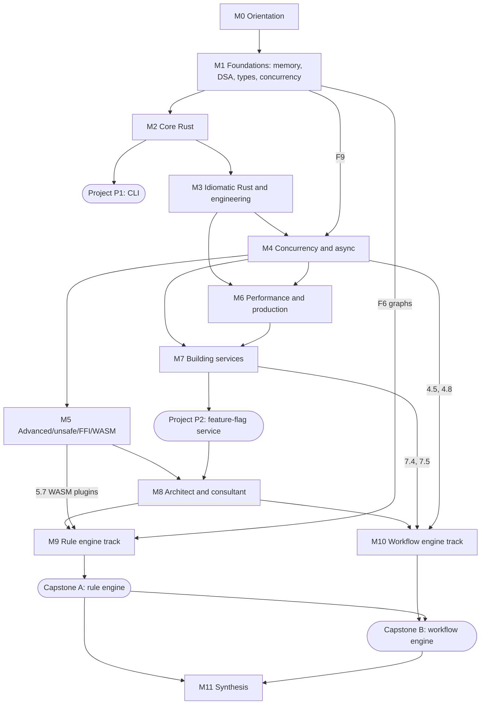

# Rust: from .NET architect to Rust expert — Phase 1 Curriculum Map

> **Status:** Waiting for your approval. No chapters are written until you approve or edit this plan.
> **Accurate as of:** 11 October 2026 · **Rust 1.99.0** (stable, released 1 Oct 2026) · **Edition 2024** (current, since Rust 1.85, Feb 2025)
> **Goal type:** detected as **programming-language**, plus **concept-mastery** for the two product tracks (rule engines, durable execution).

---

## 1. Persona analysis

### What you already bring (we will build on it, not re-teach it)
| You know (.NET) | Rust counterpart we map it to |
|---|---|
| C# syntax, generics, interfaces, LINQ, async/await, `Task` | Rust generics, traits, iterators, `Future`, async/await (looks similar but works differently) |
| `dotnet` CLI, NuGet, MSBuild, solutions/projects | `cargo`, crates.io, `Cargo.toml`, workspaces/crates |
| `IDisposable` / `using` | `Drop` / RAII (runs automatically and deterministically) |
| Exceptions | `Result<T, E>`, `?`, and `panic!` (recoverable vs unrecoverable errors) |
| `class` vs `struct`, nullable reference types | ownership, `Box`/`Rc`/`Arc`, `Option<T>` (no null) |
| ASP.NET Core, EF Core, gRPC, ILogger/OpenTelemetry | axum/tower, SQLx/Diesel/SeaORM, tonic, `tracing` + OpenTelemetry |
| Azure Durable Functions, Durable Task Framework | Temporal-style and Restate-style durable execution (Module 10) |
| Microsoft RulesEngine, possibly Drools/DMN | Rete, decision tables, DMN/FEEL, CEL, Rhai, WASM plugins (Module 9) |
| Architecture thinking: trade-offs, NFRs, ADRs | We use this throughout: every chapter has an architecture view and a decision table |

### Gaps you named, and gaps people with your background usually have
1. **Data structures and algorithms** (named). In .NET you can skip these because `List<T>` and `Dictionary<K,V>` hide them. In Rust you can't: the borrow checker makes linked structures like trees, graphs and doubly-linked lists hard to write, and a rule engine (Rete is a graph) and a workflow engine (a DAG of steps plus a priority queue of timers) are built from them.
2. **The memory model below the GC**: stack vs heap, pointers, alignment, cache locality. The CLR manages this for you, but Rust's whole design rests on it.
3. **Type-system ideas** that C# only partly has: sum types / tagged unions, exhaustive matching, "make illegal states unrepresentable".
4. **Low-level concurrency**: data races vs race conditions, memory ordering, how event loops work (epoll/kqueue/IOCP). `Task` and the thread pool hide these in .NET.
5. **How languages are built**: lexing, parsing, ASTs, interpreters, bytecode VMs. You need these for the rule engine's expression language and DSLs.
6. **Distributed-systems theory**: failure models, idempotency, delivery guarantees, logical clocks, event sourcing. You need these for a workflow engine that is correct, not just one that works in the happy path.

### Where the Foundations material sits
- **Module 1, Foundations** (before any Rust code) covers gaps 1–4.
- **Gaps 5 and 6** are taught at the start of the product tracks (9.2–9.3 and 10.1), right before they're needed, so they don't fade while you learn the core language. No chapter uses these ideas before they are taught.

---

## 2. Course shape

- **12 modules · 87 chapters**, including 2 progressive projects and 2 production capstones (plus 1 integration capstone).
- **Estimated effort:** about **400 hours** (reading, labs and exercises).
- **Suggested time plan (TIME_BUDGET = auto):** 10 h/week for about 40 weeks, ending with two working products. At 15 h/week it takes about 27 weeks. A per-week plan goes on `index.html` in Phase 5.
- **Every chapter includes:** the 12-part template you specified, "Coming from C#/.NET" boxes, exercises with solutions, at least 2 visuals built in the page (at least 1 interactive where there's a process to show), and verified "Go further" links.

| Milestone | After chapter | What you can do then |
|---|---|---|
| M-A | 2.13 (Project P1) | Write correct, idiomatic single-threaded Rust; ship a CLI tool |
| M-B | 4.8 | Write concurrent and async Rust with confidence |
| M-C | 7.7 (Project P2) | Ship a production-grade Rust microservice |
| M-D | 8.5 | Advise clients on when and how to adopt Rust (the consultant milestone) |
| M-E | 9.9 | **Product 1:** pluggable rule engine, production-ready |
| M-F | 10.10 | **Product 2:** durable workflow engine, production-ready |
| M-G | 11.2 | Both products integrated, plus your path to staying an expert |

---

## 3. Curriculum table

Legend for visuals: **[anim]** step-through animation with Play/Step/Reset · **[int]** interactive widget · **[svg]** static diagram · **[chart]** Chart.js/D3 · **[tbl]** comparison table · **[math]** KaTeX

### Module 0 — Orientation
| # | Chapter | Key concepts | Prereqs | Est. | Planned visuals |
|---|---|---|---|---|---|
| 0.1 | Why Rust, and how to use this course | What problem Rust solves (memory safety without GC); history; editions and the 6-week release train; governance; where Rust is used | — | 2h | [svg] timeline · [anim] release train · [tbl] Rust vs C#/Go/C++ first look |
| 0.2 | Toolchain and your first project | rustup, toolchains/channels, cargo, rust-analyzer in VS Code, rustfmt, clippy, `cargo doc`; .NET CLI ↔ cargo mapping | 0.1 | 2h | [svg] tool map · [anim] `cargo build` pipeline (source → MIR → LLVM → binary) |

### Module 1 — Foundations (computer science gap-fill)
| # | Chapter | Key concepts | Prereqs | Est. | Planned visuals |
|---|---|---|---|---|---|
| F1 | How a program uses memory | Bits/bytes, addresses, pointers, stack frames, heap, alignment and padding, CPU caches and locality; what the .NET GC does for you | 0.2 | 4h | [anim] call stack/heap simulator · [chart] memory latency ladder |
| F2 | Measuring cost: complexity | Big-O/Θ/Ω, amortised cost, best/worst/average case, why constants and caches still matter | F1 | 3h | [int] growth-curve explorer · [math] |
| F3 | Linear data structures | Arrays, dynamic arrays (growth strategy), linked lists, stacks, queues, deques, ring buffers | F2 | 4h | [anim] Vec growth and reallocation · [anim] ring buffer |
| F4 | Hashing and maps | Hash functions, collisions, chaining vs open addressing, SwissTable, load factor, HashDoS, sets | F3 | 3h | [anim] hash insert/probe · [tbl] map types |
| F5 | Trees and heaps | Binary trees, BST, balancing, B-trees (and why Rust's `BTreeMap` is one), binary heaps / priority queues, tries | F3 | 5h | [anim] B-tree split · [anim] heap sift-up/down |
| F6 | Graphs | Adjacency list/matrix, BFS/DFS, topological sort, cycle detection, Dijkstra, DAGs (direct lead-in to rule dependencies and workflows) | F5 | 5h | [int] BFS/DFS stepper · [anim] topological sort |
| F7 | Core algorithms and techniques | Sorting (merge, quick, hybrid sorts), binary search, recursion, divide and conquer, greedy, dynamic programming, two pointers | F2–F6 | 6h | [anim] sorting visualiser · [int] DP table filler |
| F8 | Type-system concepts | Static vs dynamic typing, value vs reference semantics, product and sum types (ADTs), generics, polymorphism styles, expressions vs statements, making illegal states unrepresentable | F1 | 3h | [svg] ADT diagrams · [tbl] C# vs Rust type features |
| F9 | Concurrency concepts | Processes/threads, scheduling, race condition vs data race, locks, deadlock, atomics (intuition), CPU-bound vs I/O-bound, event loops and readiness I/O (epoll/kqueue) vs completion I/O (IOCP) | F1 | 4h | [anim] thread interleaving · [anim] event loop |

### Module 2 — Core Rust
| # | Chapter | Key concepts | Prereqs | Est. | Planned visuals |
|---|---|---|---|---|---|
| 2.1 | Syntax and basic types | `let`, mutability, shadowing, scalar/compound types, functions, blocks as expressions, control flow, integer overflow rules | 0.2, F8 | 3h | [svg] type sizes · [tbl] C# ↔ Rust syntax |
| 2.2 | Ownership and moves | The 3 ownership rules, move vs `Copy` vs `Clone`, `Drop`, RAII vs `IDisposable` | 2.1, F1 | 4h | [anim] ownership transfer on stack/heap · [svg] drop order |
| 2.3 | Borrowing and references | `&T`/`&mut T`, aliasing XOR mutation, the borrow checker, non-lexical lifetimes | 2.2 | 4h | [anim] borrow checker step-through · [tbl] error → fix catalogue |
| 2.4 | Strings and slices | `String` vs `&str`, UTF-8, bytes vs chars, slices, `Cow` intro; vs `System.String` | 2.3 | 2h | [svg] fat pointer layout · [int] UTF-8 byte explorer |
| 2.5 | Structs, enums and pattern matching | `impl` blocks, `Option`, exhaustive `match`, `if let`, `let-else`, let chains (2024 edition), enums as state machines | 2.3, F8 | 4h | [svg] enum memory layout · [anim] state-machine enum |
| 2.6 | Error handling | `Result`, `?`, `panic!` vs recoverable errors, `From` conversions, `thiserror`/`anyhow` overview; vs exceptions | 2.5 | 3h | [anim] `?` propagation · [tbl] exceptions vs Result |
| 2.7 | Modules, crates and packages | Crate vs package vs module, visibility, `use`, paths, re-exports; vs assemblies/namespaces | 2.1 | 2h | [svg] module tree · [tbl] .NET mapping |
| 2.8 | Standard collections | `Vec`, `VecDeque`, `HashMap`, `BTreeMap`, `HashSet`, `BinaryHeap`, Entry API — linked back to F3–F5 | 2.3, F3–F5 | 3h | [tbl] collection decision table · [chart] operation costs |
| 2.9 | Generics and traits | Trait definitions, impls, bounds, `where`, default methods, `derive`, key std traits (Debug, Clone, Eq, Hash, Ord, Default, Display, From/Into, AsRef); monomorphisation; vs interfaces and C# constraints | 2.5 | 5h | [svg] monomorphisation · [tbl] interface vs trait |
| 2.10 | Closures and iterators | `Fn`/`FnMut`/`FnOnce`, captures, `Iterator`, adapters, laziness, `collect`; vs LINQ | 2.9 | 4h | [anim] iterator pipeline · [tbl] LINQ ↔ iterator |
| 2.11 | Lifetimes | Lifetime annotations, elision rules, `'static`, structs holding references, reading lifetime errors | 2.3, 2.9 | 4h | [int] lifetime scope visualiser · [svg] dangling-ref prevention |
| 2.12 | Smart pointers and interior mutability | `Box`, `Rc`, `Arc`, `Weak`, `Cell`, `RefCell`, `OnceCell`/`LazyLock`, `Deref`; trees and graphs in Rust (arenas, indices) | 2.11, F5–F6 | 5h | [anim] Rc reference counts · [svg] arena-based graph |
| 2.13 | **Project P1:** log-analysis CLI | clap, file I/O, parsing, errors, tests, packaging a binary | 2.1–2.12 | 8h | [svg] architecture · [anim] processing pipeline |

### Module 3 — Idiomatic Rust and engineering practice
| # | Chapter | Key concepts | Prereqs | Est. | Planned visuals |
|---|---|---|---|---|---|
| 3.1 | Trait mastery | Associated types, trait objects, dyn compatibility (formerly "object safety"), static vs dynamic dispatch, vtables, blanket impls, coherence/orphan rule, marker and auto traits, extension traits | 2.9, 2.12 | 5h | [svg] vtable layout · [tbl] generics vs `dyn` |
| 3.2 | Idioms and anti-patterns | Newtype, builder, typestate, RAII guards, conversion traits; anti-patterns (clone everywhere, `Rc<RefCell>` everywhere, fighting the borrow checker); the Rust API Guidelines | 3.1 | 4h | [anim] typestate transitions · [tbl] idiom vs anti-pattern |
| 3.3 | Error design at scale | Library vs application errors, error enums, context, backtraces, error boundaries (HTTP, FFI, workers) | 2.6, 3.1 | 3h | [svg] error-flow across layers · [tbl] crate choices |
| 3.4 | Testing | Unit/integration/doc tests, test layout, mocking through traits, property testing (proptest), snapshot testing (insta), nextest, coverage | 2.13 | 4h | [svg] test pyramid for Rust · [tbl] xUnit ↔ Rust |
| 3.5 | Cargo in depth | Workspaces, features and feature unification, profiles, build scripts, dependency resolution, semver and lockfiles, private registries, MSRV, cargo-semver-checks | 2.7 | 4h | [anim] feature unification · [svg] workspace layout |
| 3.6 | Docs, lints and code quality | rustdoc, doctests, clippy lint configuration, rustfmt, lint levels, a review checklist | 3.4 | 2h | [tbl] lint groups · [svg] quality-gate pipeline |
| 3.7 | Debugging and tooling | rust-analyzer, CodeLLDB/gdb, `dbg!`, panics and backtraces, `cargo expand`, reading compiler errors | 2.13 | 2h | [anim] panic unwind · [svg] tool map |
| 3.8 | Standard library tour | io, fs, path, env, process, time, fmt, sync, thread, net; what is *not* in std, and the de-facto crates for it | 3.1 | 3h | [svg] std module map · [tbl] std vs ecosystem crates |

### Module 4 — Concurrency and async
| # | Chapter | Key concepts | Prereqs | Est. | Planned visuals |
|---|---|---|---|---|---|
| 4.1 | Threads, `Send` and `Sync` | spawn, scoped threads, `move`, auto traits, what "fearless concurrency" does and does not guarantee | 3.1, F9 | 3h | [anim] data-race rejected at compile time · [tbl] Send/Sync matrix |
| 4.2 | Shared state and message passing | `Mutex`, `RwLock`, `Condvar`, channels (std mpsc, crossbeam), poisoning, lock granularity; vs `lock`/`Monitor` | 4.1 | 3h | [anim] producer/consumer · [svg] deadlock cycle |
| 4.3 | Atomics and memory ordering 🔬 | Relaxed/Acquire/Release/SeqCst, happens-before, lock-free basics, ABA, build a spinlock | 4.2 | 5h | [anim] instruction reordering · [svg] happens-before graph |
| 4.4 | Data parallelism | rayon, work stealing, parallel iterators; vs `Parallel.ForEach`/PLINQ | 4.1, 2.10 | 2h | [anim] work stealing · [chart] speedup curve |
| 4.5 | How async really works | `Future`, `poll`, wakers, async fn as compiler-generated state machine, executor vs runtime; lazy Rust futures vs hot .NET Tasks | 4.1, 2.5 | 5h | [anim] poll/wake loop · [svg] generated state machine |
| 4.6 | Pin, async traits and async closures | Self-referential futures, `Pin`/`Unpin`, async fn in traits, async closures, `Send` bounds on futures | 4.5, 2.11 | 4h | [anim] why moving a self-referential future breaks · [tbl] async feature status |
| 4.7 | Tokio in practice | Runtime flavours, tasks, `spawn_blocking`, `select!`, timeouts, cancellation and cancellation safety, `JoinSet`, structured concurrency, graceful shutdown, backpressure (bounded channels, `Semaphore`) | 4.6 | 6h | [anim] select! cancellation · [svg] shutdown sequence |
| 4.8 | Verifying concurrent code | loom (model checking), Miri, Tokio time control, deterministic simulation (turmoil) | 4.3, 4.7 | 3h | [anim] loom exploring interleavings · [tbl] tool comparison |

### Module 5 — Advanced and expert Rust
| # | Chapter | Key concepts | Prereqs | Est. | Planned visuals |
|---|---|---|---|---|---|
| 5.1 | Unsafe Rust | The five unsafe superpowers, safety invariants, soundness, the main kinds of undefined behaviour, raw pointers, building safe abstractions, Miri | 4.3, 2.12 | 5h | [svg] safe/unsafe boundary · [tbl] UB catalogue |
| 5.2 | Memory layout, variance and drop check 🔬 | `repr`, niche optimisation, ZSTs, DSTs/fat pointers, `PhantomData`, variance, drop check | 5.1 | 4h | [int] layout explorer · [tbl] variance table |
| 5.3 | Declarative macros | `macro_rules!`, fragment specifiers, repetition, hygiene, when (not) to use | 3.1 | 3h | [anim] macro expansion · [tbl] macro vs generic vs fn |
| 5.4 | Procedural macros | derive/attribute/function-like, syn/quote, compile-time cost | 5.3 | 4h | [svg] token stream pipeline · [anim] derive expansion |
| 5.5 | Advanced type system | GATs, higher-ranked trait bounds (`for<'a>`), const generics, `impl Trait` in all positions, sealed traits, compile-time state machines | 3.1, 2.11 | 4h | [svg] HRTB intuition · [tbl] feature/use-case |
| 5.6 | FFI and interop | C ABI, `extern`, bindgen/cbindgen, **Rust ↔ .NET** (P/Invoke, csbindgen), PyO3, panics and ownership across boundaries | 5.1 | 5h | [anim] call across FFI · [svg] .NET ↔ Rust interop options |
| 5.7 | WebAssembly and plugins | wasm32 targets, wasmtime, WASI, Component Model and WIT, host/guest design, sandbox limits (fuel, memory) | 5.6 | 5h | [anim] host↔guest call · [svg] component model |
| 5.8 | `no_std`, embedded and other targets (breadth) | `core`/`alloc`/`std` layers, embedded-hal, Embassy, targets and tiers | 5.1 | 2h | [svg] core/alloc/std layers · [tbl] target tiers |

### Module 6 — Performance and production engineering
| # | Chapter | Key concepts | Prereqs | Est. | Planned visuals |
|---|---|---|---|---|---|
| 6.1 | Measuring performance | criterion benchmarks, profilers (perf, flamegraph, samply), allocation profiling (dhat), compile-time measurement | 3.4 | 3h | [int] flamegraph reading · [chart] benchmark distribution |
| 6.2 | Optimisation techniques | Fewer allocations, data layout and cache, bounds-check elimination, SIMD intro, LTO/PGO/codegen-units, alternative allocators | 6.1, F1 | 4h | [chart] before/after · [anim] cache-line access |
| 6.3 | Observability | `tracing`, spans, structured logs, metrics, OpenTelemetry export; vs ILogger/`Activity` | 4.7 | 3h | [anim] span tree · [svg] telemetry pipeline |
| 6.4 | Security and supply chain | RustSec/cargo-audit, cargo-deny, cargo-vet, SBOM, auditing unsafe, fuzzing (cargo-fuzz), secrets handling | 3.5 | 3h | [svg] supply-chain gates · [tbl] tool matrix |
| 6.5 | Build, CI/CD and release | Build caching, cross-compiling, musl/static builds, small containers, reproducibility, managing compile times, versioning/publishing | 3.5 | 3h | [svg] CI pipeline · [chart] build-time levers |
| 6.6 | Operating Rust services | Config layering, health checks, graceful shutdown, panics in production, timeouts/retries/circuit breakers (tower) | 4.7 | 3h | [anim] circuit breaker states · [svg] resilience stack |

### Module 7 — Building services
| # | Chapter | Key concepts | Prereqs | Est. | Planned visuals |
|---|---|---|---|---|---|
| 7.1 | Serialisation with serde | derive, attributes, data formats (JSON, binary, Protobuf via prost), schema evolution | 3.1 | 3h | [svg] serde data model · [tbl] format comparison |
| 7.2 | HTTP APIs with axum and tower | Routing, extractors, shared state, middleware/layers, error responses; vs ASP.NET Core minimal APIs | 4.7, 7.1 | 5h | [anim] request through tower layers · [tbl] ASP.NET ↔ axum |
| 7.3 | gRPC with tonic | Protobuf contracts, streaming, interceptors, interop with .NET gRPC clients | 7.2 | 3h | [svg] contract-first flow · [anim] bidi stream |
| 7.4 | Data access | SQLx (compile-time checked queries), pools, transactions, migrations; Diesel/SeaORM comparison; vs EF Core | 7.2 | 5h | [svg] pool and transaction lifecycle · [tbl] ORM comparison |
| 7.5 | Messaging and event-driven design | Kafka and NATS clients, outbox pattern, idempotent consumers, delivery semantics | 7.4 | 4h | [anim] outbox relay · [svg] consumer groups |
| 7.6 | AuthN/AuthZ and multi-tenancy | OIDC/JWT validation, policy checks, tenant isolation models | 7.2 | 3h | [svg] auth flow · [tbl] tenancy models |
| 7.7 | **Project P2:** tenant-aware feature-flag service | axum + SQLx + tracing + tests + Docker + CI; production-readiness checklist (deliberately a small rules problem, as a warm-up for Module 9) | 7.1–7.6, 6.x | 12h | [svg] architecture · [anim] flag evaluation |

### Module 8 — Rust architect and consultant
| # | Chapter | Key concepts | Prereqs | Est. | Planned visuals |
|---|---|---|---|---|---|
| 8.1 | When to use Rust | Fit by use case (CLI, services, data, embedded, WASM, systems, infra, ML); Rust vs C#/Go/Java/C++/Zig; total cost of ownership | M2–M7 | 3h | [int] decision-tree advisor · [tbl] language trade-offs |
| 8.2 | Ecosystem map and choosing crates | Evaluating crates (maintenance, unsafe use, licences, MSRV), key crates by domain | 8.1 | 2h | [svg] ecosystem map · [tbl] crate-evaluation scorecard |
| 8.3 | Adoption and migration strategy | Incremental adoption, coexisting with .NET estates (FFI, sidecars, gRPC), strangler fig, team ramp-up, hiring, risk register | 8.1, 5.6 | 3h | [svg] adoption roadmap · [anim] strangler-fig migration |
| 8.4 | Architecture patterns in Rust | Hexagonal/clean architecture with traits, DI without containers, plugin architectures, actors, ECS (overview) | 3.1, 7.x | 4h | [svg] hexagonal layout · [tbl] DI in .NET vs Rust |
| 8.5 | Reviewing Rust systems | Verified real-world case studies; code and architecture audit checklist; production-readiness review | 8.1–8.4 | 3h | [tbl] audit checklist · [chart] case-study outcomes (sourced only) |

### Module 9 — Product A: pluggable enterprise rule engine
| # | Chapter | Key concepts | Prereqs | Est. | Planned visuals |
|---|---|---|---|---|---|
| 9.1 | Rule systems landscape | Production rules, forward/backward chaining, decision tables/trees, DMN and FEEL, scorecards, expression rules (CEL), Datalog; products (Drools, MS RulesEngine, GoRules Zen); enterprise requirements | F6, M8 | 4h | [svg] taxonomy of evaluation styles · [tbl] style vs use-case |
| 9.2 | Language implementation I: parsing | Lexing, recursive descent, Pratt parsing, AST design with enums, spans and error messages | 2.5, F5 | 5h | [anim] Pratt parser step-through · [svg] AST |
| 9.3 | Language implementation II: evaluation | Name resolution, type checking, tree-walking interpreter vs closure compilation vs bytecode VM, constant folding | 9.2 | 6h | [anim] stack VM execution · [chart] evaluator performance |
| 9.4 | Rete and match algorithms 🔬 | Alpha/beta networks, working memory, agenda and conflict resolution, incremental matching; compiling decision tables; hit policies | 9.1, F6 | 6h | [anim] Rete network propagating facts · [tbl] algorithm trade-offs |
| 9.5 | Engine core architecture | Pluggable `Evaluator` trait design, fact model (typed vs dynamic values), sessions, explainability traces, determinism | 9.3, 3.1 | 5h | [svg] plugin architecture · [anim] evaluation trace |
| 9.6 | Extensibility and sandboxing | Trait objects vs dynamic libraries (ABI caveats) vs WASM components; embedding Rhai and CEL; custom functions; resource limits | 9.5, 5.7 | 5h | [svg] plugin options · [tbl] isolation vs performance |
| 9.7 | Rule management platform | Storage, versioning, rollout, authoring API, validation, simulation/testing, audit, multi-tenancy | 9.5, 7.x | 5h | [svg] lifecycle · [anim] versioned rollout |
| 9.8 | Performance and scale | Benchmarking, caching compiled rules, parallel evaluation, hot reload (`ArcSwap`), memory footprint | 9.5, 6.x | 4h | [chart] throughput/latency · [anim] hot reload |
| 9.9 | **Capstone A:** build and harden | End-to-end assembly, gRPC/HTTP API, .NET client, deployment, production-readiness checklist | 9.1–9.8 | 20h | [svg] full architecture · [int] rule playground |

### Module 10 — Product B: durable long-running workflow engine
| # | Chapter | Key concepts | Prereqs | Est. | Planned visuals |
|---|---|---|---|---|---|
| 10.1 | Distributed-systems foundations | Failure models, partitions, logical clocks (Lamport), delivery semantics, idempotency, consistency models, consensus overview (Raft) | F9, 7.5 | 6h | [anim] Lamport clocks · [anim] at-least-once with retries |
| 10.2 | Durable execution concepts | Workflows vs activities, event history, deterministic replay, journaling; Temporal, Restate, Azure Durable Functions, Step Functions compared | 10.1 | 4h | [anim] replay rebuilds state · [tbl] engine comparison |
| 10.3 | Modelling workflows | Code-first vs DSL, state machines, DAGs, sagas and compensation | 10.2, F6 | 4h | [anim] saga with compensation · [svg] DAG model |
| 10.4 | Persistence layer | Event sourcing, Postgres schema, optimistic concurrency, snapshots, outbox, retention | 10.2, 7.4 | 5h | [svg] schema · [anim] append + snapshot |
| 10.5 | Task dispatch | Task queues, leases/heartbeats, visibility timeouts, retries with backoff, rate limits, priorities, sharding | 10.4, F5 | 5h | [anim] lease expiry and redelivery · [chart] backoff curves |
| 10.6 | Timers, signals and long-running state | Durable timers, cron, signals/queries/updates, human-in-the-loop, child workflows, continue-as-new | 10.5 | 4h | [anim] timer wheel/heap · [svg] signal flow |
| 10.7 | Determinism and versioning | Sources of non-determinism, versioning/patching in-flight workflows, migrations | 10.3 | 4h | [anim] non-determinism detected on replay · [tbl] versioning strategies |
| 10.8 | SDK design in Rust | Workflow authoring API, a custom deterministic async executor (builds on 4.5), macros, multi-language workers over gRPC | 10.7, 4.6, 5.4 | 6h | [anim] deterministic executor · [svg] SDK layers |
| 10.9 | Reliability engineering | Deterministic simulation testing, fault injection, observability, HA and scale-out, backpressure, multi-tenancy, security | 10.8, 4.8, 6.3 | 5h | [anim] simulated failure run · [svg] HA topology |
| 10.10 | **Capstone B:** build and harden | End-to-end assembly; uses the Capstone A rule engine as a decision step; deployment; production-readiness checklist | 10.1–10.9, 9.9 | 24h | [svg] full architecture · [int] live workflow-history viewer |

### Module 11 — Synthesis
| # | Chapter | Key concepts | Prereqs | Est. | Planned visuals |
|---|---|---|---|---|---|
| 11.1 | Integration and productisation | Both products together, packaging and licensing options, deployment models (SaaS/self-host), customer onboarding | 9.9, 10.10 | 6h | [svg] combined platform · [tbl] deployment models |
| 11.2 | Staying an expert | Reading RFCs and the Reference, following releases, contributing upstream, consultant toolkit and spaced review | all | 2h | [svg] learning loop · [tbl] review schedule |

**Totals:** 87 chapters · about 400 h, including exercises and the 3 build projects (P1 8h, P2 12h, capstones 20h + 24h + 6h).

---

## 4. Prerequisite dependency diagram

Module level (chapter-level arrows are in the "Prereqs" column; Phase 5 makes this map clickable on `index.html`):

**Fast-track option for consultancy work:** if you need to advise clients early, Module 8 can be read right after M-C (7.7). It only links to M5 for the FFI/WASM material, and you can come back to that.

---

## 5. Gap check: topics experts cover that courses often skip

| Often-skipped topic | Why it matters for you | Where it is covered |
|---|---|---|
| DSA through Rust's ownership lens (graphs/trees with arenas and indices) | Rete networks and workflow DAGs | F5, F6, 2.12 |
| Variance, drop check, `PhantomData` | Needed to design safe generic APIs | 5.2 |
| `Pin` and self-referential futures | Workflow SDK's custom executor | 4.6, 10.8 |
| Cancellation safety in async | Lost messages and corrupted state in long-running services | 4.7 |
| Memory ordering | Lock-free queues and counters in engines | 4.3 |
| dyn compatibility, coherence/orphan rule | Plugin APIs for the rule engine | 3.1, 9.5 |
| Cargo feature unification, semver hazards, MSRV | Shipping enterprise libraries/SDKs | 3.5 |
| Supply-chain security (cargo-deny/vet/audit, SBOM) | Enterprise customers will ask | 6.4 |
| Panics across FFI, unwinding vs abort | .NET interop and plugin safety | 5.6, 3.7 |
| Testing concurrency (loom), Miri, fuzzing | Proving engine correctness | 4.8, 5.1, 6.4 |
| Deterministic simulation testing | The standard way to make durable engines trustworthy | 4.8, 10.9 |
| Compile-time management (build times) | Real cost on large workspaces | 6.5 |
| Workflow versioning of in-flight executions | The hardest operational problem in durable workflows | 10.7 |
| Rule explainability and audit trails | A regulatory need in finance/insurance rule engines | 9.5, 9.7 |
| WASM Component Model for sandboxed plugins | Lets customers plug in "any evaluation style" safely | 5.7, 9.6 |
| Adoption/migration strategy, team ramp-up | The consultant side of TARGET_OUTCOME | 8.3 |

All 16 are included in the curriculum.

---

## 6. Sources used to define scope (all checked live on 11 Oct 2026)

**Official Rust project**
- The Rust Programming Language ("the Book") — https://doc.rust-lang.org/book/
- Brown University interactive edition of the Book (with ownership quizzes) — https://rust-book.cs.brown.edu/
- Rust by Example — https://doc.rust-lang.org/rust-by-example/
- The Rust Reference — https://doc.rust-lang.org/reference/
- The Rustonomicon (unsafe Rust) — https://doc.rust-lang.org/nomicon/
- Standard library docs — https://doc.rust-lang.org/std/
- The Cargo Book — https://doc.rust-lang.org/cargo/
- Edition Guide, Rust 2024 — https://doc.rust-lang.org/edition-guide/rust-2024/index.html
- Asynchronous Programming in Rust (async book) — https://rust-lang.github.io/async-book/
- Rust API Guidelines — https://rust-lang.github.io/api-guidelines/
- Release notes — https://github.com/rust-lang/rust/blob/master/RELEASES.md · Rust 1.99.0 announcement — https://blog.rust-lang.org/2026/10/01/Rust-1.99.0/

**Courses and syllabi**
- Google, Comprehensive Rust (4-day fundamentals + concurrency/bare-metal/Android/Chromium tracks) — https://google.github.io/comprehensive-rust/
- Microsoft, Rust for C#/.NET Developers — https://microsoft.github.io/rust-for-dotnet-devs/latest/
- Tokio tutorial — https://tokio.rs/tokio/tutorial
- Rustlings — https://github.com/rust-lang/rustlings · Exercism Rust track — https://exercism.org/tracks/rust

**Books** (full books, not online summaries)
- Jon Gjengset, *Rust for Rustaceans* (No Starch) — https://nostarch.com/rust-rustaceans
- Mara Bos, *Rust Atomics and Locks* (free online) — https://marabos.nl/atomics/
- Luca Palmieri, *Zero To Production in Rust* — https://www.zero2prod.com/
- David Drysdale, *Effective Rust* (free online) — https://effective-rust.com/
- Tim McNamara, *Rust in Action* (Manning) — https://www.manning.com/books/rust-in-action
- Blandy, Orendorff & Tindall, *Programming Rust*, 2nd ed. (O'Reilly). ⚠ The publisher page blocks automated checks, so it is cited without a link.
- Nicholas Nethercote, *The Rust Performance Book* — https://nnethercote.github.io/perf-book/
- *Rust Design Patterns* — https://rust-unofficial.github.io/patterns/
- *Learning Rust With Entirely Too Many Linked Lists* — https://rust-unofficial.github.io/too-many-lists/
- Robert Nystrom, *Crafting Interpreters* — https://craftinginterpreters.com/
- Martin Kleppmann, *Designing Data-Intensive Applications* — https://dataintensive.net/
- Sedgewick & Wayne, *Algorithms*, 4th ed. (site) — https://algs4.cs.princeton.edu/home/

**Papers** (verified through Crossref)
- C. L. Forgy, "Rete: A fast algorithm for the many pattern/many object pattern match problem," *Artificial Intelligence*, 1982 — https://doi.org/10.1016/0004-3702(82)90020-0
- H. Garcia-Molina & K. Salem, "Sagas," *SIGMOD '87*, 1987 — https://doi.org/10.1145/38713.38742
- L. Lamport, "Time, clocks, and the ordering of events in a distributed system," *CACM*, 1978 — https://doi.org/10.1145/359545.359563
- R. Jung, J.-H. Jourdan, R. Krebbers, D. Dreyer, "RustBelt: securing the foundations of the Rust programming language," *POPL/PACMPL*, 2017 — https://doi.org/10.1145/3158154

**Product-track references** (rule engines and durable execution)
- OMG DMN specification — https://www.omg.org/spec/DMN/
- Microsoft RulesEngine (.NET) — https://github.com/microsoft/RulesEngine
- GoRules Zen engine (Rust) — https://github.com/gorules/zen
- cel-rust — https://github.com/cel-rust/cel-rust · Rhai book — https://rhai.rs/book/
- Wasmtime — https://docs.wasmtime.dev/ · WASM Component Model — https://component-model.bytecodealliance.org/
- Temporal workflows docs — https://docs.temporal.io/workflows · Temporal Rust core SDK — https://github.com/temporalio/sdk-core
- Restate (Rust-based durable execution) — https://github.com/restatedev/restate · https://docs.restate.dev/
- Azure Durable Functions overview — https://learn.microsoft.com/en-us/azure/azure-functions/durable/durable-functions-overview
- Pratt parsing (matklad) — https://matklad.github.io/2020/04/13/simple-but-powerful-pratt-parsing.html
- turmoil (deterministic simulation) — https://github.com/tokio-rs/turmoil · loom — https://github.com/tokio-rs/loom · Miri — https://github.com/rust-lang/miri

**Video channel** (individual videos are checked per chapter in Phase 3)
- Jon Gjengset — https://www.youtube.com/@jonhoo

---

## 7. ⚠ Items to verify while writing chapters (Phase 3)
- The exact Rust version that stabilised **let chains** in the 2024 edition (believed to be 1.88) — chapter 2.5.
- The current algorithms behind `slice::sort` / `sort_unstable` (believed to be driftsort / ipnsort since about 1.81) — chapter F7.
- The current status of async closures, async fn in traits, and `Send` bounds on async trait methods — chapter 4.6.
- Real-world Rust case studies: only ones with a primary source will be used — chapter 8.5.
- Latest crate major versions (axum, tonic, SQLx, wasmtime, tokio) — pinned and tested per chapter.

---

## 8. Decisions I need from you
1. **Approve the scope** (87 chapters, about 400 h), or tell me what to trim or extend.
2. **Breadth topics:** keep 5.8 (embedded/`no_std`) as a short breadth chapter, or drop it?
3. **Database for the workflow engine:** Postgres only (recommended: simpler, familiar), or also a pluggable storage trait with an embedded option (e.g. SQLite/RocksDB)?
4. **Order of the tracks:** consultancy module (M8) early on the fast track, or keep the default order?

Reply **"approved"** (with any edits) and I'll move to Phase 2 (design system).
